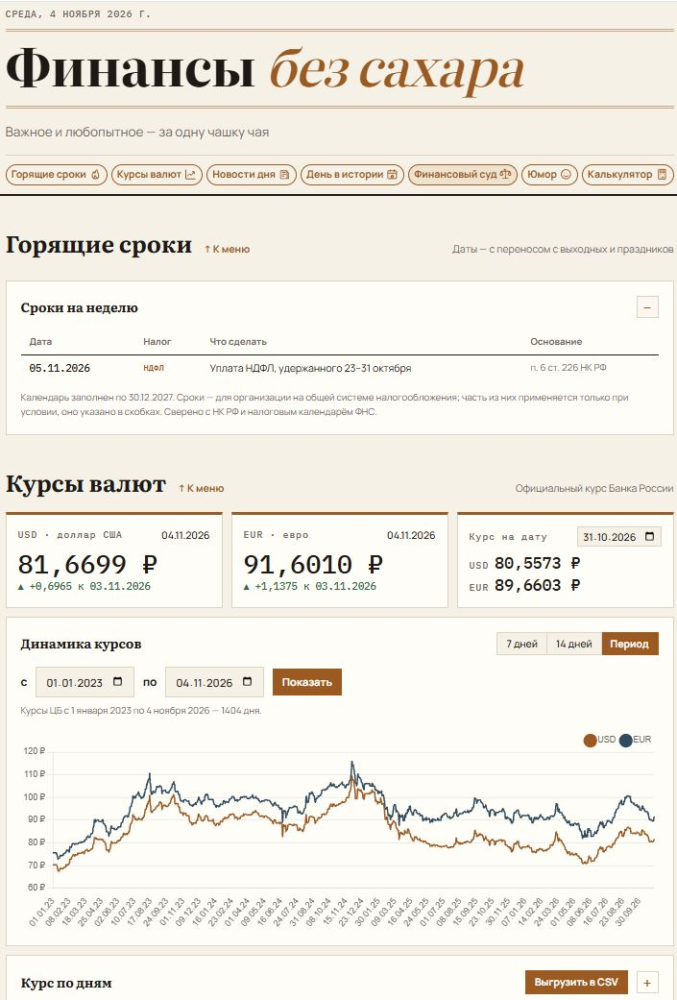
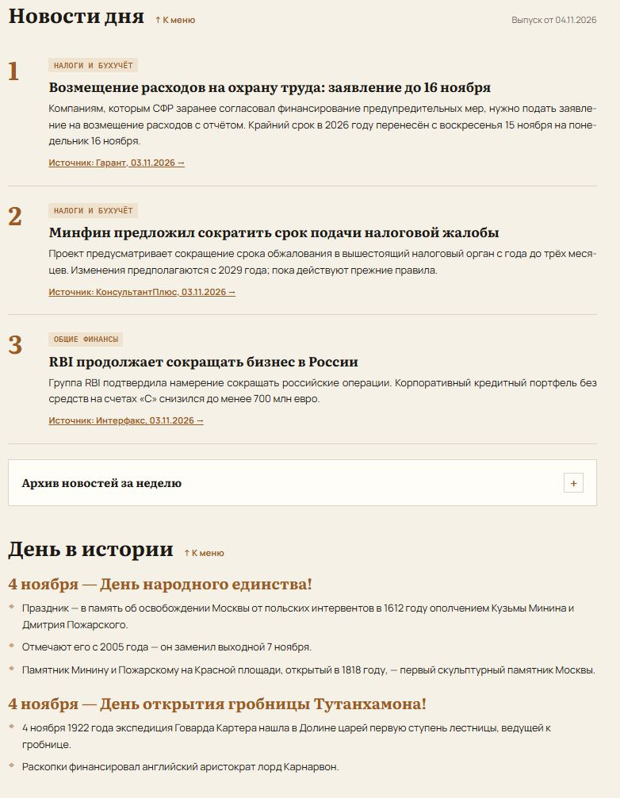
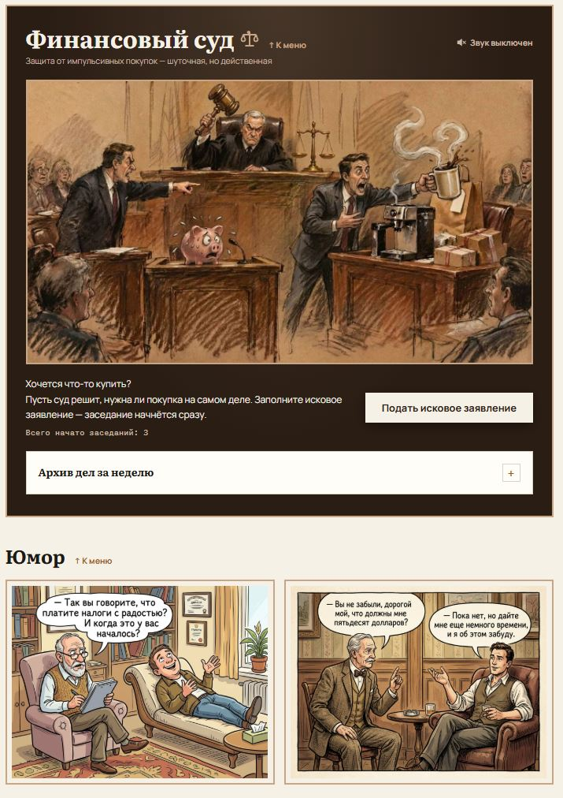
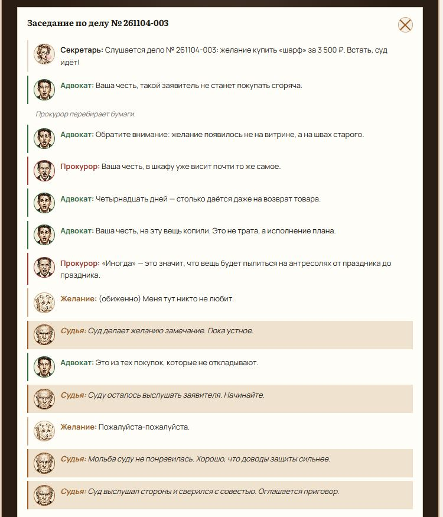
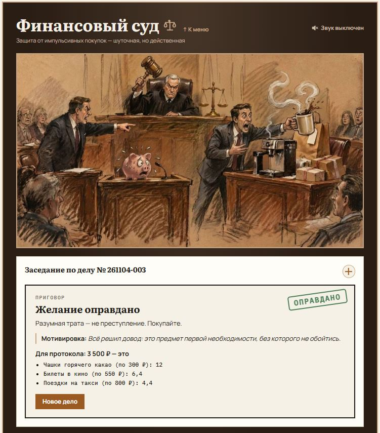
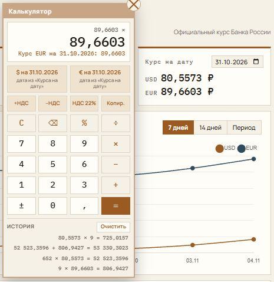

# Финансы без сахара

Информационный сайт-агрегатор с полезными инструментами для работы и позитивного начала дня за чашкой чая: курсы валют, важные финансовые новости, налоговые сроки, улучшенный калькулятор, интерактивный «Финансовый суд» и юмор в картинках.

**Сайт:** [nosugarfin.ru](https://nosugarfin.ru)

Для использования откройте ссылку в браузере на компьютере или телефоне. Установка не требуется.

Сайт опубликован на Спринтхосте и доступен по HTTPS. Доступность подтверждена 04.11.2026.

## Проблема

Сотрудникам финансового отдела и бухгалтерии приходится проверять курсы валют, отслеживать налоговые сроки и искать изменения законодательства в разных источниках. Это занимает время и повышает риск пропустить важную информацию.

Проект собирает необходимые сведения в одном месте и помогает быстро ознакомиться с ними в начале рабочего дня.

## Пользователь

Основная аудитория — сотрудники финансового отдела и бухгалтерии. Дополнительная аудитория — коллеги из отдела продаж и пользователи, которым интересны подобные новости и инструменты.

## Основная функция

Сайт объединяет несколько инструментов:

- **Курсы валют.** Показывает официальные курсы USD и EUR, изменения, график и таблицу. Пользователь выбирает дату или период и получает соответствующие курсы с возможностью выгрузки в CSV.
- **Горящие сроки.** По текущей дате показывает налоговые обязательства на сегодня и свёрнутый список сроков на ближайшие семь дней.
- **Новости дня.** По ручной команде /news ИИ-помощник ищет и проверяет финансовые новости, готовит краткий выпуск со ссылками на источники. После согласования владельцем выпуск сохраняется для сайта.
- **Калькулятор.** Выполняет арифметические действия, расчёты НДС со ставками 10% и 22%, позволяет использовать в расчетах курс валюты на дату, а также ведет историю расчетов с возможностью копирования результатов в окно текущих вычислений.
- **Финансовый суд.** Пользователь вводит желаемую покупку, стоимость, отвечает на вопросы и подписывает заявление. Сайт проводит шуточное заседание и выносит приговор, помогая избежать импульсивных покупок.
- **День в истории и юмор.** Показывает факты о праздниках и две картинки дня. Картинки проходят полный цикл до повторения.

В последнем слове суда три вида ответа идут в постоянном порядке: честный довод, просьба и «суду виднее». Они корректируют решение по ответам в заявлении, но не задают три фиксированных приговора.

## Формат результата

Готовый сайт для компьютера и телефона. Пользователь получает актуальную подборку финансовой информации, таблицы и графики курсов, CSV-файл для работы в Excel, результаты вычислений и интерактивный разбор покупки.

История калькулятора и дел «Финансового суда» сохраняется в браузере пользователя. При начале заседания сайт получает единый номер для всех посетителей в формате ГГММДД-NNN (порядковый номер не сбрасывается по дням) и показывает общее число начатых заседаний. Покупки, ответы и суммы на сервер не отправляются.

## Минимальный функционал

В первую версию вошли:

- отображение курсов USD и EUR;
- просмотр курсов на выбранную дату;
- график, таблица и выгрузка курсов;
- выпуск финансовых новостей со ссылками и недельным архивом;
- адаптивная страница для компьютеров и телефонов.

В ходе разработки дополнительно реализованы налоговый календарь, калькулятор, «Финансовый суд», разделы праздников и юмора, сохранение пользовательской истории и автоматические проверки.

В дальнейшем планируется упростить загрузку обновлений на хостинг, развивать словарь покупок и сценарии суда, продлевать налоговый календарь.

## Технологии

- **HTML, CSS, JavaScript** — структура, оформление и интерактивность сайта.
- **Chart.js** — графики курсов валют.
- **PowerShell** — обновление истории курсов и списка картинок, запуск проверок.
- **PHP 7.4+ и PDO SQLite** — единая нумерация начатых заседаний суда.
- **Данные Банка России и зеркало cbr-xml-daily.ru** — источники курсов.
- **JavaScript-файлы данных** — хранение новостей, календаря и сценариев суда.
- **localStorage** — сохранение истории и настроек в браузере.
- **CSV** — выгрузка курсов для Excel.
- **Claude Code** — разработка первоначальной версии и помощь в подготовке содержимого; дальнейшие доработки выполнялись с помощью Codex.
- **Спринтхост** — размещение файлов сайта; зарегистрирован домен nosugarfin.ru.

Основные разделы работают в браузере. Общая нумерация «Финансового суда» использует PHP и SQLite на Спринтхосте. ИИ используется при разработке и подготовке новостей, а интерактивные функции сайта выполняются в браузере без обращения к ИИ.

## Локальный запуск

Откройте index.html в современном браузере. Для свежих курсов и загрузки Chart.js требуется интернет. Собственная история и настройки относятся к текущему браузеру и адресу сайта.

## Обновление данных

В чате помощника из папки проекта введите /news. Помощник обновит курсы и список картинок, подготовит выпуск и дождётся согласования перед записью новостей и архива.

Отдельные команды из корня проекта:

- powershell -NoProfile -ExecutionPolicy Bypass -File update-rates.ps1 — обновить курсы.
- powershell -NoProfile -ExecutionPolicy Bypass -File update-humor.ps1 — обновить список и очередь картинок.
- powershell -NoProfile -ExecutionPolicy Bypass -File tests/run-tests.ps1 — проверить сайт и 100 заседаний суда. Параметр -Cases 300 увеличивает число заседаний.

Автозапуск Windows отключён. run-news.ps1 сохранён как заглушка и не обновляет сайт.

## Структура проекта

- index.html — страница.
- css/ — оформление.
- js/ — логика разделов.
- api/ — серверный счётчик заседаний суда.
- data/ — курсы, новости, календарь и сценарии суда.
- pictures/ и sounds/ — изображения и звук.
- tests/ — автоматические проверки.
- .claude/skills/fin-no-sugar/SKILL.md — скилл сопровождения проекта для Claude Code. Остальные локальные инструкции исключены из репозитория.
- Журналы и результаты локальных проверок исключены из репозитория.

## Размещение

Сайт размещён на Спринтхосте и доступен по адресу https://nosugarfin.ru/. Домен и HTTPS работают; проверка 04.11.2026 — HTTP 200.

В public_html загружаются index.html и папки css, js, data, pictures, sounds, api. index.html должен лежать прямо в public_html. Локальные инструкции, журналы, тесты, документацию, PowerShell-скрипты и ZIP-архивы на сайт не загружают. После распаковки установочный ZIP удаляют с хостинга.

При обновлении суда загрузите в public_html сначала api/court-counter.php, затем js/court.js и index.html. Версия ссылки на js/court.js в index.html помогает браузерам загрузить новый код. На сайте нужен PHP 7.4 или новее с PDO SQLite. Обработчик сам создаёт папку nosugarfin-private рядом с public_html и базу court.sqlite внутри неё; PHP должен иметь право записи туда. Проверка после загрузки: https://nosugarfin.ru/api/court-counter.php должен вернуть JSON с полем count. Затем начните по одному заседанию на двух устройствах: номера должны различаться, а общий счёт — увеличиться на два.

Общий счёт начинается с нуля при первом включении: прежние заседания хранятся отдельно в браузерах, их общий итог неизвестен. Базу nosugarfin-private/court.sqlite сохраняйте при обновлениях и включайте в резервные копии; не заменяйте пустой базой. При недоступности счётчика новое заседание не начинается — повторите отправку после восстановления связи. Локальный index.html сохраняет прежнюю нумерацию браузера для проверки.

После локального обновления изменённые файлы нужно загрузить на хостинг. Изображения для публичного размещения должны использоваться с разрешения правообладателей.

Полный однократный сброс суда согласован 04.11.2026: новая версия js/court.js удаляет все ключи court-* (архив, память реплик, копилку, условные сроки, локальный счётчик, выбор портретов и звука). Данные других разделов сохраняются. Маркер court-full-reset-20261104-v1 предотвращает повторную очистку новых дел. api/court-counter.php однократно очищает серверные номера и начинает общий отсчёт заново с 1; маркер в таблице migrations сохраняется при дальнейших обновлениях. Для включения сначала загрузить api/court-counter.php, затем js/court.js и index.html. Очистка на хостинге выполняется после загрузки новой версии: на сервере — при первом запросе к обработчику, в каждом браузере — при открытии обновлённой страницы. Факт выполнения последнего полного сброса на хостинге пока не подтверждён. Открыть сайт заново на каждом устройстве; уже открытые вкладки тоже перезагрузить. Базу вручную удалять не нужно.

## Ограничения

- Налоговый календарь заполнен до декабря 2027 года и требует продления.
- Новости обновляются вручную; у каждой есть источник и дата публикации.
- Узнавание покупок основано на словаре и не охватывает все возможные формулировки.
- История браузера не переносится между устройствами и может исчезнуть после очистки данных.
- Данные и примерные цены финансового суда служат для развлекательного сценария.

## Работа с репозиторием GitHub

Скопируйте проект с помощью GitHub CLI:

```powershell
gh repo clone ElenaF1985/fin-no-sugar
cd fin-no-sugar
```

Сборка и установка npm-пакетов не требуются. Для знакомства с интерфейсом откройте `index.html` в браузере. В режиме `file://` суд использует локальную нумерацию; PHP API так не запускается. Для общего счётчика нужен сервер PHP 7.4+ с расширением PDO SQLite. GitHub Pages не исполняет PHP, поэтому полная версия сайта размещена на отдельном хостинге.

Для локальной проверки PHP API можно запустить из корня проекта:

```powershell
php -S localhost:8000
```

После этого откройте `http://localhost:8000`. Обработчик создаёт `nosugarfin-private/court.sqlite` в родительской папке проекта. Используйте отдельную тестовую копию и тестовую базу: в коде присутствует однократная миграция полного сброса суда. Маркер `court-full-reset-20261104-v1` при обычных обновлениях менять нельзя.

## Проверки

Основная проверка интерфейса и сценариев суда требует Windows и Microsoft Edge:

```powershell
powershell -NoProfile -ExecutionPolicy Bypass -File tests/run-tests.ps1
```

Проверка клиентской части общего счётчика требует Node.js:

```powershell
node tests/court-counter-test.js
```

Для проверки также серверного API передайте путь к PHP с PDO SQLite:

```powershell
node tests/court-counter-test.js C:/path/to/php.exe
```

Проверки используют отдельные тестовые данные. Отчёт `tests/last-report.txt` не включается в Git.

## Состав репозитория и материалы

Репозиторий содержит код сайта, файлы открытых справочных данных, изображения, звуки, скрипты обновления и тесты. Личные инструкции владельца, служебные журналы, секреты, базы SQLite и архивы выгрузок исключены через `.gitignore`. Исключение — опубликованный скилл сопровождения проекта.

Автоматическое развёртывание не настроено: отправка коммита в GitHub не обновляет сайт на хостинге. Изображения и звуки перед дальнейшим публичным распространением требуют проверки прав. Открытая лицензия на материалы проекта в репозитории не предоставлена.

## Скриншоты проекта

### Главная страница




### Финансовый суд




### Калькулятор


## Скилл сопровождения проекта

Папка [.claude/skills/fin-no-sugar/](.claude/skills/fin-no-sugar/) содержит [SKILL.md](.claude/skills/fin-no-sugar/SKILL.md) — инструкции для сопровождения сайта в Claude Code: устройство проекта, локальный запуск, точечные изменения, проверки, обновление README и подготовка файлов для хостинга.

В Claude Code, открытом в корне проекта, вызовите `/fin-no-sugar` и укажите задачу. Скилл не добавляет ИИ на сам сайт и не запускает публикацию автоматически.

Упомянутые в скилле `PROJECT.md`, `AGENTS.md` и соседний навык `news` относятся к локальному окружению владельца и в репозиторий не включены. Для работы с опубликованной копией используйте этот README и текущий код; отдельный редакционный процесс `/news` требует своего навыка.